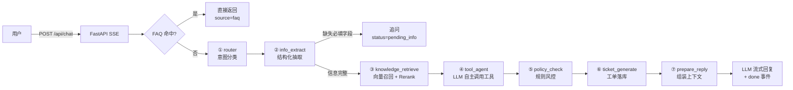

# 物流售后多 Agent 客服

基于 **LangGraph** 的物流售后智能客服：七节点工作流编排，LLM 自主 tool-calling、RAG 政策检索 + Rerank、SSE 真流式回复，以及不依赖大模型的确定性风控与工单/人工复核闭环。

## 核心特性

- **七节点工作流**：意图路由 → 信息抽取 → 政策检索 → 工具调用 → 规则风控 → 工单生成 → 回复组装，状态在节点间显式流转。
- **真 tool-calling**：把 `query_order` / `query_logistics` / `check_refund_eligibility` 以 OpenAI function schema 交给模型，由模型自行决定调用哪些工具、并行调用，并用早停策略控制轮次。
- **真 RAG**：Chroma（cosine）+ 阿里百炼 Embedding 召回，`TextReRank` 二次重排；按 `source` 增量更新，MD5 跳过未变更文件；回答带 `[来源: 文件名#片段序号]` 引用。
- **真流式**：`POST /api/chat` 返回 `text/event-stream`，逐节点推送 `stage` 事件，最终回复直接转发模型 token，而非伪流式切片。
- **确定性风控**：退款金额阈值（≤50 自动 / 50–500 人工 / >500 主管）、理赔与换货强制人工、订单不存在强制人工，全部由规则引擎判定，不让 LLM 决定是否放款。
- **工单闭环**：自动生成工单并落库，支持按工单号查询与人工复核（通过/驳回）。
- **可评测**：内置 20 条标注测试集与离线评测脚本，输出意图、抽取、状态、人工转接、工具调用率与耗时。

## 架构



风控规则与政策文档保持一致：

| 订单金额 | 处理方式 |
| --- | --- |
| ≤ 50 元 | 自动退款 |
| 50–500 元 | 人工审核 |
| > 500 元 | 售后主管审批 |
| 破损理赔 / 换货 / 投诉 | 强制人工 |
| 订单不存在 | 强制人工核实 |

## 技术栈

FastAPI · LangGraph · LangChain · ChromaDB · OpenAI 兼容 SDK（火山方舟 Ark）· 阿里百炼 Embedding / Rerank · SQLite · SSE

## 目录结构

```text
.
├── main.py                     # FastAPI 入口：SSE 接口、工单接口、启动初始化
├── index.html                  # 原生 JS 聊天页（解析 SSE）
├── data/
│   └── shouhouguize.txt        # 售后政策知识库（可替换为 PDF）
├── src/
│   ├── agent/
│   │   ├── graph_builder.py    # LangGraph 七节点编排
│   │   ├── nodes.py            # 各节点实现
│   │   ├── prompts.py          # router / extract / react / reply 提示词
│   │   ├── tools.py            # 工具 schema 与执行器
│   │   ├── policy.py           # 确定性风控规则
│   │   ├── services.py         # 工单服务
│   │   └── state.py            # 工作流状态定义
│   ├── rag/
│   │   ├── ingest.py           # 切分、MD5 增量、Chroma 入库
│   │   └── retriever.py        # 召回 + 阈值过滤 + Rerank
│   ├── db/database.py          # 订单、物流、工单、会话历史
│   ├── faq/                    # 高频政策问题短路
│   ├── evaluation/
│   │   ├── dataset.json        # 20 条标注测试集
│   │   └── run_eval.py         # 离线评测脚本
│   ├── schemas.py              # Pydantic 模型
│   ├── clients.py              # LLM / Embedding 客户端
│   ├── config.py               # 环境变量与阈值
│   └── observability.py        # 节点 / LLM / 工具日志
├── requirements.txt
├── .env.example
└── LICENSE
```

## 快速开始

```bash
# 1. 安装依赖（建议 Python 3.10+）
python -m venv .venv
source .venv/bin/activate        # Windows: .venv\Scripts\activate
pip install -r requirements.txt

# 2. 配置密钥
cp .env.example .env             # 填入 Ark 与 DashScope 密钥

# 3. 启动（首次启动会自动建库并把 data/ 入库）
uvicorn main:app --host 0.0.0.0 --port 8000
```

打开 <http://127.0.0.1:8000> 即可对话。可直接试用：

- `订单DD20260901001物流到哪了`
- `我要退款，订单DD20260910004`（39 元，自动通过）
- `我要退款，订单DD20260910003`（680 元，转人工）
- `我要退款`（缺订单号，触发追问）

启动时会做三件事：初始化 SQLite、按 MD5 增量同步 `data/` 到 Chroma、编译 LangGraph。知识库为空时会自动重建，无需手动清库。

## 接口说明

### `POST /api/chat`

```json
{ "session_id": "sess_xxx", "user_input": "订单DD20260901001物流到哪了" }
```

返回 `text/event-stream`，事件类型：

| 事件 | 字段 | 说明 |
| --- | --- | --- |
| `stage` | `node` / `label` / `detail` | 节点进度，如 `router · query_logistics` |
| `token` | `content` | 回复增量文本 |
| `done` | `ticket_id` / `status` / `need_human` / `citations` / `elapsed` | 结束事件 |

`status` 取值：`ai_solved` / `pending_human` / `pending_info` / `error`。

### 其他接口

| 方法 | 路径 | 说明 |
| --- | --- | --- |
| `GET` | `/api/tickets/{ticket_id}` | 查询工单 |
| `POST` | `/api/tickets/{ticket_id}/review` | 人工复核：`{"approved": true, "comment": "..."}` |
| `GET` | `/api/health` | 健康检查 |

## 评测

测试集见 [dataset.json](src/evaluation/dataset.json)，覆盖物流查询、退款三档金额、换货、理赔、投诉、缺字段追问、部分退款缺商品编号、订单不存在、FAQ 短路等场景。

```bash
# 先启动服务，再运行
python -m src.evaluation.run_eval --base-url http://127.0.0.1:8000
```

2026-10-25 本地实测（20 条，单次串行回放）：

| 指标 | 结果 |
| --- | --- |
| 意图准确率 | 100%（18/18，FAQ 样本不参与） |
| 信息抽取准确率 | 100%（18/18） |
| 工单状态准确率 | 100%（20/20） |
| 人工转接准确率 | 100%（20/20） |
| 工具调用率（应调用样本） | 100% |
| 工具误调用 | 0 次 |
| RAG 引用覆盖率 | 77.8% |
| FAQ 命中 | 2/2 |
| 平均耗时 | 8.27 s |
| P95 耗时 | 12.44 s |

> 单次串行回放；首条样本包含冷启动与外部接口抖动，整体耗时偏保守。

## 设计要点

- **关闭思考模式**：分类/抽取/工具选择都是短决策，请求带 `extra_body={"thinking": {"type": "disabled"}}`，把单次决策从几十秒压到 1–3 秒。
- **结构化抽取双保险**：`response_format={"type":"json_object"}` 约束 JSON 输出，正则兜底订单号；缺失字段由确定性规则计算，不信任模型自报。
- **工具早停**：物流查询拿到 `query_logistics` 即停；退款/换货/理赔拿到订单金额即停，避免无意义的工具循环。
- **检索可降级**：Embedding / Rerank 超时后熔断 60 秒，改用本地字符 bigram 关键词检索，工作流继续用工具结果与规则结论回复，不会整条链路失败或每条请求都等 15 秒。
- **规则与 LLM 解耦**：金额、人工转接等关键决策由 `PolicyEngine` 计算，模型只负责表达。
- **可观测**：节点、LLM token 用量、工具耗时统一写入日志，便于定位慢点。

## 局限与 Roadmap

- 目前使用 SQLite 模拟订单/物流，生产环境需替换为真实订单中台接口。
- 会话历史仅保留最近 6 轮，未做长期记忆与用户画像。
- FAQ 为关键词匹配，后续可改为语义检索。
- 可扩展：多轮槽位补全、工单异步处理、人工坐席实时接管、LangGraph checkpoint 持久化。

## License

[MIT](LICENSE)
